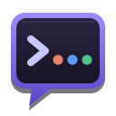
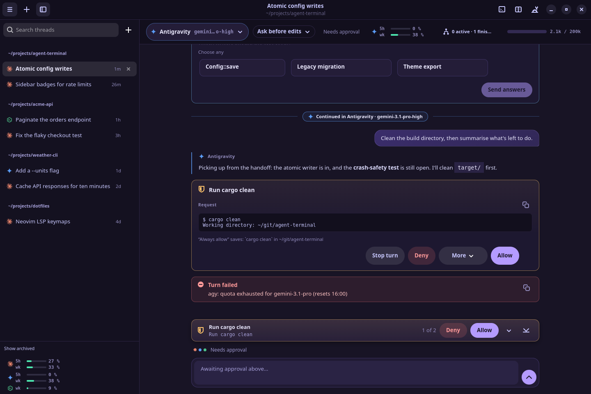

<p align="center">
  
</p>

# Agent Terminal

[](https://github.com/jean1880/nuvek-agent-terminal/actions/workflows/ci.yml)
[](https://github.com/jean1880/nuvek-agent-terminal/releases)
[](https://scorecard.dev/viewer/?uri=github.com/jean1880/nuvek-agent-terminal)
[](LICENSE)

A native Linux desktop app for working with AI coding agents. Claude Code, Antigravity
(`agy`) and Codex run as chat threads, with approvals, plans, diffs and undo built in.
A terminal is always one keystroke away. It's written in Rust with GTK4 and libadwaita,
and it ships as a single binary.



> Agent Terminal is an independent project, not affiliated with Anthropic, Google or OpenAI.
> It drives their command-line tools, which you install and sign in to yourself.
>
> **Antigravity notice:** Google has restricted Antigravity accounts for use
> of third-party tools that bypassed Google's supplied tooling. Agent Terminal uses the
> Google-supplied `agy` CLI rather than bypassing it, but Google has not said whether a
> GUI that drives that CLI is exempt from its third-party-tools rule. Google controls
> enforcement and may change its rules or restrict access at its discretion. Use it only
> if you accept that risk; this project makes no promise that access will remain
> available. See [Google's Antigravity Terms](https://www.antigravity.google/terms),
> its [account-restriction notice](https://discuss.ai.google.dev/t/update-on-antigravity-tos-ban/131424)
> and [Using Antigravity](docs/antigravity.md).

## Highlights

- **Switch agents mid-conversation.** Move a thread between Claude, Antigravity and Codex; the new agent is handed the conversation so far.
- **One window, three agents.** One searchable sidebar of threads grouped by folder, including sessions you already ran in the CLIs.
- **You stay in control.** One approval card for every agent, a plan panel, and questions as cards with answers to pick.
- **Approval rules you own.** Session and always rules live in Agent Terminal and apply to all three agents.
- **Git safety net.** Each turn is checkpointed into hidden refs; diff, undo and per-agent worktrees never touch your branch, index or stash.
- **Your desktop, your colours.** A bundled theme, six classics, or follow your desktop's GTK theme, light or dark.

| Approvals | Model and agent picker |
|---|---|
|  |  |

## Requirements

Linux with **GTK 4.10+**, **libadwaita 1.5+**, **VTE 0.72+** (GTK4 build) and **GtkSourceView 5**:
Ubuntu 24.04, Debian 13, Fedora 40, current Arch, or newer. Install at least one agent CLI:
`claude`, `agy` or `codex`. Agent Terminal finds them on your `PATH`, in the usual install folders and
through your login shell.

## Install

Packages for each release are attached to the
[GitHub Releases](https://github.com/jean1880/nuvek-agent-terminal/releases) page, with `SHA256SUMS`.

```bash
sudo apt install ./agent-terminal_<version>_amd64.deb                   # Debian / Ubuntu
sudo dnf install ./agent-terminal-<version>-1.x86_64.rpm                # Fedora
sudo pacman -U ./agent-terminal-<version>-1-x86_64.pkg.tar.zst          # Arch Linux
```

Check a download with `sha256sum --check --ignore-missing SHA256SUMS`. Verification, build provenance,
uninstalling and building from source are in [Installing and uninstalling](docs/install.md) and
[Building from source](docs/building.md).

## Quick start

1. Start `agent-terminal` from your app menu. The first start opens a short setup that checks which agents are installed and signed in.
2. Press `Ctrl+Shift+T` to start a thread, type a request and press Enter.
3. Approve the commands and edits the agent asks for, or make a rule from the card.
4. Press `Ctrl+Shift+D` to see what changed; the diff panel's undo arrow puts a turn back.

## Documentation

- [Walkthrough](docs/walkthrough.md): the app, step by step, with screenshots
- [Features](docs/features.md): switching agents, threads, approvals and rules, the git safety net, terminals
- [Configuration and options](docs/configuration.md): command-line options, environment variables, keyboard shortcuts, settings, profiles and agy's approval hook
- [Reference](docs/reference.md): resuming sessions, hand-offs, status indicators, checkpoints, diffs, undo and worktrees
- [Delegation](docs/delegation/user-guide.md) and [multi-agent environment review](docs/multi-agent-environment-review.md)
- [Installing and uninstalling](docs/install.md), [Building from source](docs/building.md) and [Troubleshooting](docs/troubleshooting.md)

## Security

Agent Terminal exposes no ports. Persisted and injected text is redacted, hand-off briefs are written
`0600` outside any project, and its git checkpoints never touch your index, branch or stash. The one
outbound request is an optional update check, which Settings can turn off. Report vulnerabilities
privately as described in [SECURITY.md](SECURITY.md).

## Troubleshooting

- **Logs:** `journalctl --user -t agent-terminal -b`, or run with `RUST_LOG=debug agent-terminal`.
- **"No AI CLI detected":** install `claude`, `agy` or `codex`, or set its full path in Settings → Agents.
- **An agent is stuck:** ☰ → **Restart Agent** (`Ctrl+Shift+R`).
- **agy edits files in Plan mode:** install agy's [approval hook](docs/configuration.md#agys-approval-hook).

More in [Troubleshooting](docs/troubleshooting.md).

## Related projects

- [nuvek-cross-agent](https://github.com/jean1880/nuvek-cross-agent): the headless delegation CLI; it reads the usage and model catalogue files Agent Terminal writes
- [nuvek-hive-board](https://github.com/jean1880/nuvek-hive-board): a shared board for agent teams, reachable from the agents as an MCP server
- [nuvek-agent-sync](https://github.com/jean1880/nuvek-agent-sync) and [nuvek-agent-config](https://github.com/jean1880/nuvek-agent-config): one agent configuration for Claude Code, Antigravity and Codex
- [nuvek-core](https://github.com/jean1880/nuvek-core): the shared Rust libraries behind them

## Support

If Agent Terminal saves you time, you can support its development:

- [Ko-fi](https://ko-fi.com/jean1880)

No pressure at all: bug reports and kind words help just as much.

## Contributing

Bug reports, ideas and pull requests are welcome. [CONTRIBUTING.md](CONTRIBUTING.md) covers
reporting a bug, setting up a build, testing and opening a pull request. Everyone taking part
follows the [Code of Conduct](CODE_OF_CONDUCT.md). Report security problems privately, as
described in [SECURITY.md](SECURITY.md).

## Licence

Agent Terminal is free software, released under the [MIT Licence](LICENSE).
