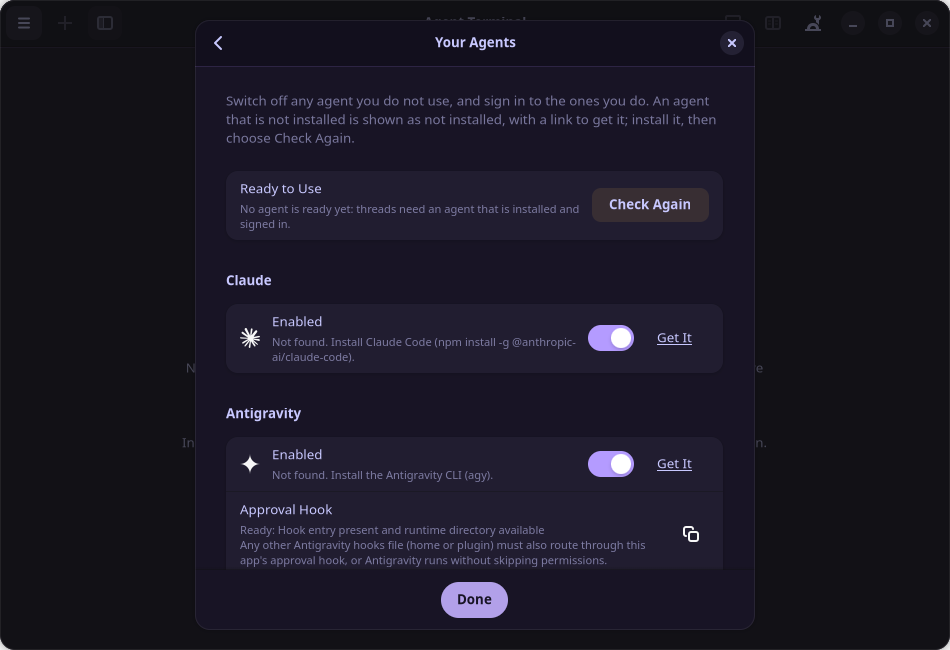
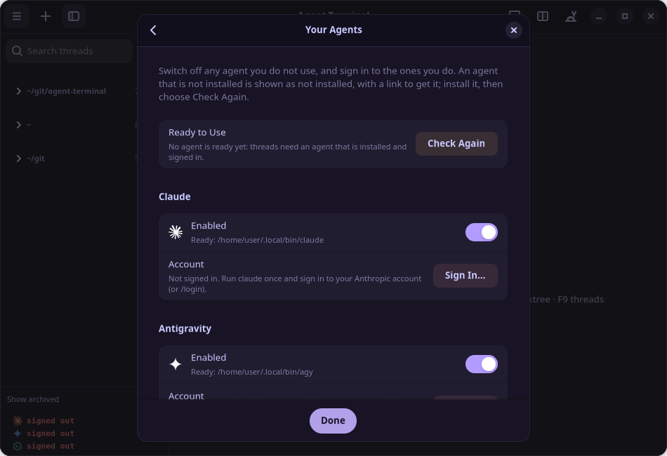
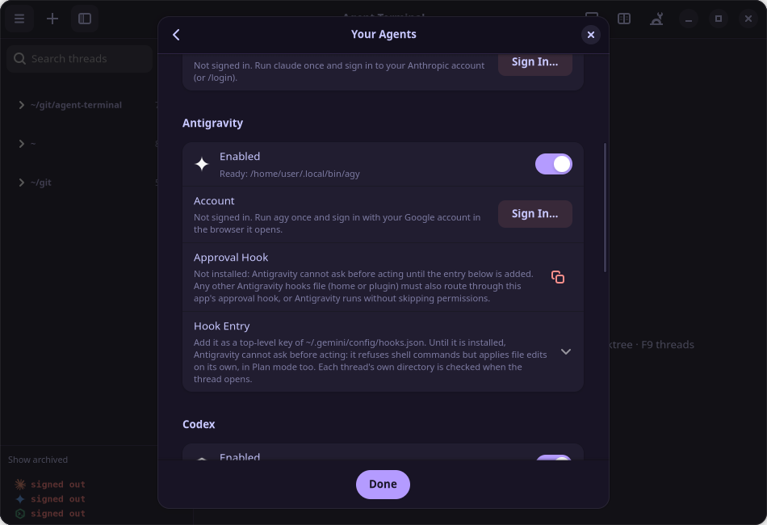
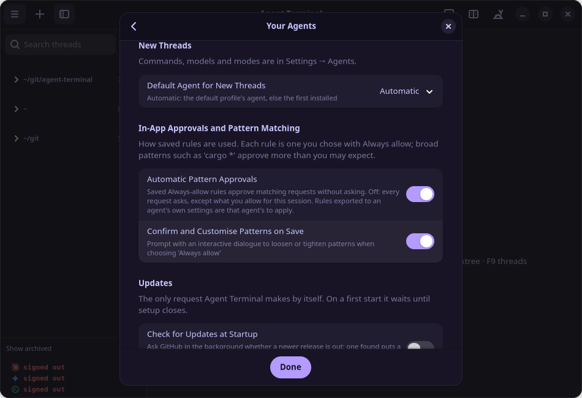
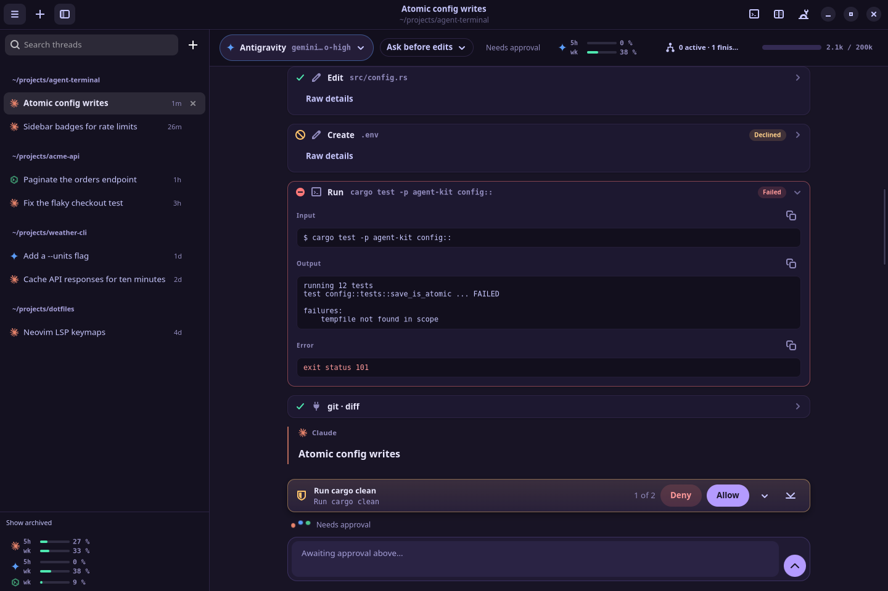
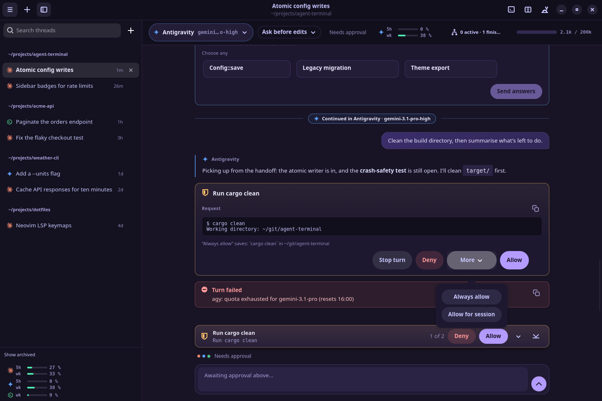
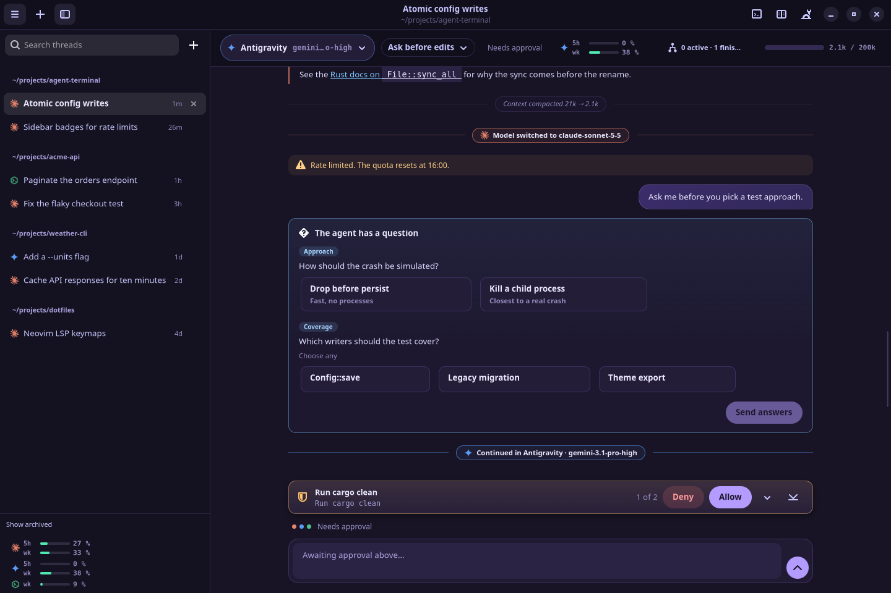
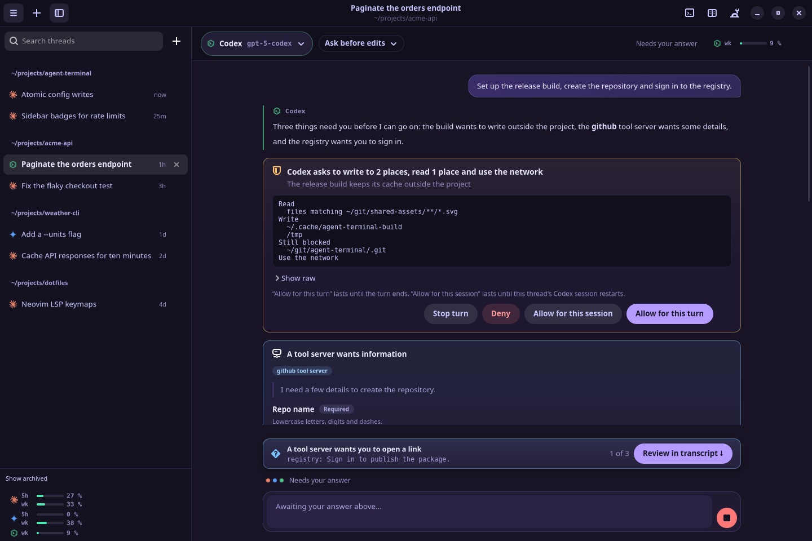
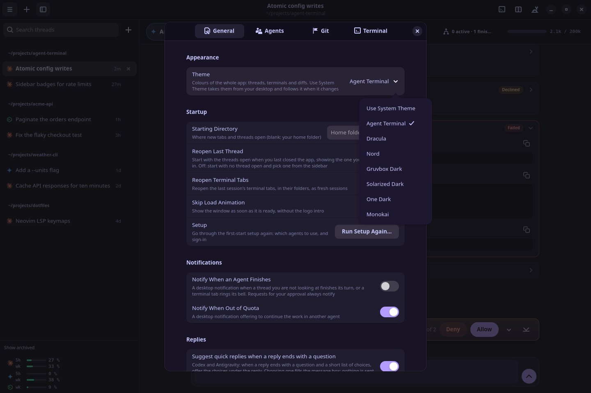
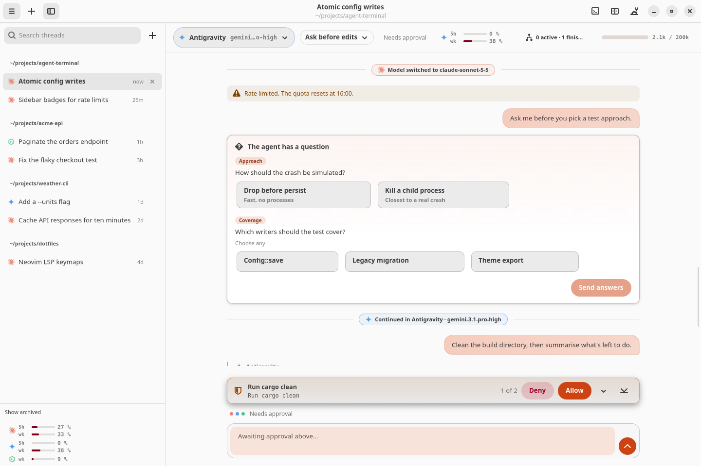

# Walkthrough

The screenshots below come from the app's demo mode (`AGENT_TERMINAL_DEMO_THREADS=1`):
scripted threads, no agent running.

### 1. First start

Launch Agent Terminal from your app menu, or run `agent-terminal`. The first start opens
a short setup of two pages, a welcome and **Your Agents**. Every switch on them applies at
once, and all of them are in Settings later.

**Your Agents** shows:

- **Who is ready.** The top row names the agents that are installed and signed in, or says
  that none is ready yet.
- **Each agent.** Whether it is installed (with a link to get it if not, and **Check
  Again** once you have), whether it is switched on, and who is signed in, with **Sign In…**
  if nobody is.
- **Antigravity's approval hook.** Whether it is installed. Without it, agy applies file
  edits by itself in every mode. Setup never edits agy's files: **Copy** gives you the entry
  to add yourself (see [agy's approval hook](configuration.md#agys-approval-hook)).
- **New threads.** Which agent they start on.
- **Approvals.** Whether your saved **Always allow** rules approve matching requests without
  asking (see [Approvals and rules](features.md#approvals-and-rules)), and whether saving one first lets
  you loosen or tighten its pattern.
- **Updates.** Whether to check GitHub for a new release at startup. On a first start the
  check waits until setup closes.

Setup writes Agent Terminal's own settings file and nothing in any agent's configuration.
Run it again any time from Settings → General → **Run Setup Again…**.

| Nothing installed yet | Installed, not signed in |
|---|---|
|  |  |

| Antigravity's approval hook | Approvals and updates |
|---|---|
|  |  |

### 2. Start a thread and ask

Start a thread with `Ctrl+Shift+T` or the **+** button. It opens in the current folder;
the menu (☰) → **New Thread in Existing Folder…** picks another, and **New Thread in
Isolated Git Worktree…** gives the agent its own checkout. Type a request and press
Enter. `/` lists commands, `@` mentions files and `$` picks skills. The mode picker
beside the agent switches between **Ask before edits**, **Accept edits** and **Plan**.

### 3. Follow the work

Replies render markdown, code and tables. Every tool call is a card with the same
grammar for every agent (`Read <path>`, `Run <command>`, `Edit <path>`, `<server>/<tool>`),
marked done, failed or declined, with its input, output and errors behind it. Reasoning,
the plan and sub-agents each get their own block.

| | |
|---|---|
|  |  |
| Markdown, code and tables. | Tool cards: done, declined and failed. |

### 4. Approve, deny or make a rule

When the agent wants to run a command or edit a file, an approval card shows exactly
what it asks for. **Allow** answers once, **More** offers **Allow for session** and
**Always allow**, **Deny** lets the agent see the refusal and carry on, and **Stop turn**
ends the turn. A panel above the composer keeps the pending approval within reach while
you scroll, and the keyboard answers it too (`Ctrl+Enter` allows, `Ctrl+Backspace` denies).
See [Approvals and rules](features.md#approvals-and-rules).

### 5. Answer questions, add to a running turn

Questions the agent asks come as cards with answers to pick. A message you send while a
turn is running reaches Claude and Codex at once, inside that turn. For Antigravity it
waits in a queue pinned under the reply and goes out when the turn ends; `Up` in an empty
composer takes the last queued one back to edit.

| | |
|---|---|
|  |  |
| Model switches, rate limits and a question. | Queued prompts. |

### 6. Switch model or agent

The chip at the left of the thread's header (or `/model`) opens one picker for every
installed agent, with search and effort levels. Pick a model from another agent and the
thread carries on there, with the conversation handed over. Models that Antigravity
serves on Google's quota are marked *via Antigravity*. Usage for each agent sits beside
the picker and at the foot of the sidebar. See
[Switching agents](features.md#switching-agents-mid-conversation).

### 7. When Codex needs more

Codex can ask for access beyond its sandbox, and tool servers behind it can ask for
details or a sign-in. Each request is a card that says exactly what is asked: what it
would read or write, what stays blocked, whether it wants the network, and which host a
link opens.

| | |
|---|---|
|  |  |
| Extra access, for this turn or this session. | A tool server's form. |

### 8. See and undo changes

`Ctrl+Shift+D` opens the diff panel: uncommitted work, the last turn, everything since
the thread opened, or the target branch. Its undo arrow puts the last turn's changes back,
and the undo can itself be undone. `` Ctrl+` `` opens a shell in the thread's folder.
See [Git safety net](features.md#git-safety-net).

### 9. Make it yours

Settings (`Ctrl+,`) apply as you change them. Pick the bundled theme, one of six classics,
or **Use System Theme** to follow your desktop, light or dark.

| | |
|---|---|
|  |  |
| Themes apply to the whole app, live. | **Use System Theme** on a light desktop. |

**Using Antigravity?** Install its [approval hook](configuration.md#agys-approval-hook) so it asks
before it acts.

